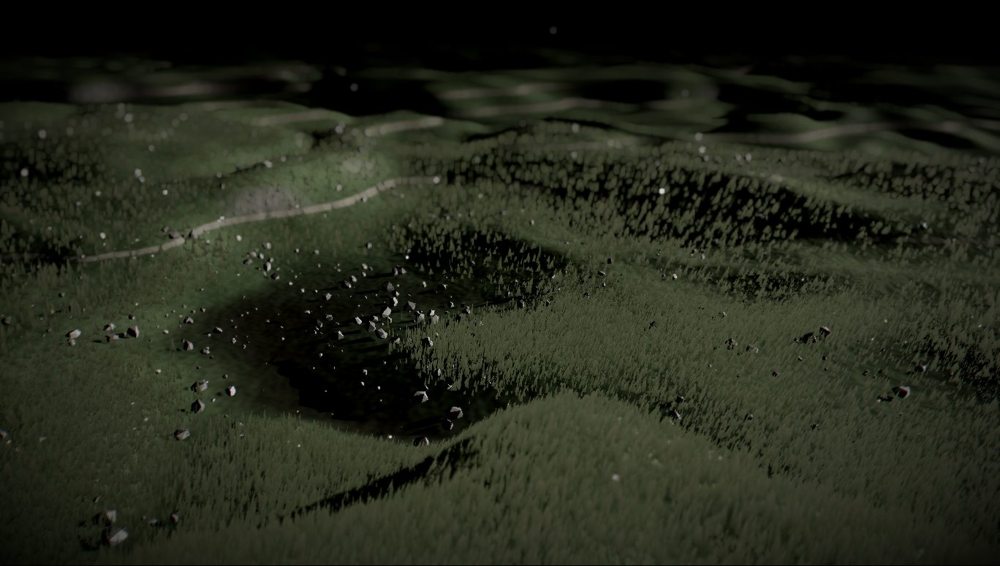
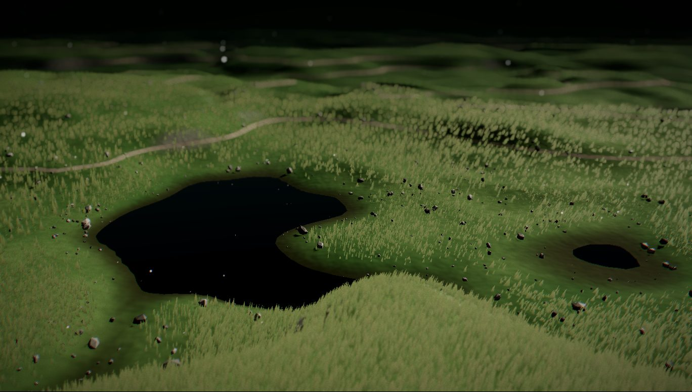
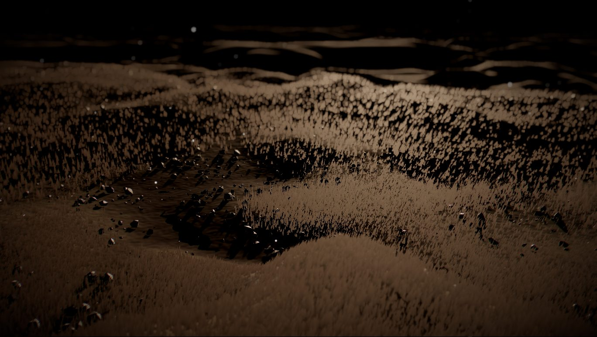
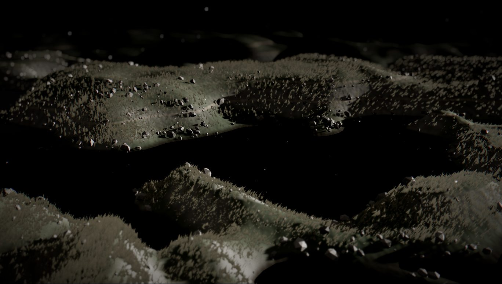
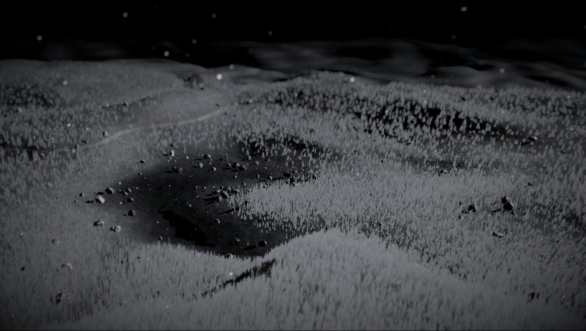

# Meadow Walk

An endless, unhurried flight over a windy meadow at dusk. Half a million blades of grass, a few ponds,
paths worn into the hills, and a cursor that sends soft waves rolling through the field. Every number
that shapes it is on a slider.

**Live demo:** https://kloserock97-tech.github.io/meadow-walk/



## The idea

The meadow is one function. Height at any point of the ground is a warped fractal noise, and everything
that stands on the ground asks that function where the ground is: the terrain mesh, every blade of grass,
every pebble, the shadow pass and the camera. Asking it directly would mean evaluating the noise half a
million times per pass, so it is asked once. Each frame the height of the area around the camera is drawn
into a half-float texture, and all the shaders only read from it.

The camera needs the ground too, to stay above the hills and to find where the cursor points, so the same
function lives once more in JavaScript. The noise is built on an integer hash rather than the usual
`fract(sin(...))`, and integer arithmetic in JavaScript (`Math.imul`, `>>> 0`) reproduces the GPU
bit for bit. The cursor lands exactly on the blade it is over.

## The grass

Two layers of instanced blades, both placed entirely in the vertex shader:

- **near:** 360,000 tapered blades of five vertices on a 26×26 patch in front of the camera, receiving shadows,
- **far:** 140,000 single triangles on a 70×70 patch, wider and cheaper, without shadows.

Further away the grass is only a colour of the ground, and the fog does the rest. Each blade wraps around
the camera with `mod`, so the patches follow the walk without any bookkeeping. A blade skips water and
worn paths, grows in clumps, and bends under a travelling wave plus slow gusts of noise. The wind keeps its
own clock, so changing its speed changes the tempo instead of making the field jump.

## The cursor

Moving the cursor leaves a trail of points. Each point sends out a ring that grows, fades in and slowly
breathes out; grass, pebbles and dust all read one shared field built from those rings. On the crest a
pebble lifts a little and slides outwards, the grass lies down, the dust rises, and when the ring has
passed everything settles back where it was. Nothing is simulated, so nothing drifts: positions are a pure
function of the rings that are still alive.

## The look

A low sun and long shadows, a near-black sky, and a film-like finish: exposure, depth of field on the
foreground, bloom, a little lens fringing, ACES tone mapping, grading, a mid-tone grain and a vignette.
The grain is written by hand: stock noise redraws white noise over the whole frame every monitor refresh,
which reads as flicker on a dark image. Here it lives only in the mid-tones and changes 24 times a second,
like film. The wind you can switch on is synthesised with Web Audio from filtered noise; there are no
audio files.

## Controls

| Folder | What's in it |
| --- | --- |
| **Walk** | speed, lowest and highest flight, path sway, how much the camera looks around, freeze time |
| **Meadow** | hill height and frequency, water level, colours of lowlands, slopes, dry crests, rock, paths and ponds |
| **Grass** | density, blade height and width, wind strength and speed, root, tip and dry-tip colours |
| **Stones** | amount, size, colour |
| **Light and air** | sun height, direction, colour and strength, sky light, sky colour, haze, dust amount and size |
| **Cursor waves** | strength, speed, how long they last |
| **Look** | exposure, saturation, contrast, bloom, foreground blur, lens fringing, film grain, vignette |
| **View** | lines of text over the field, wind sound, adaptive quality |

`H` hides the panel, `Space` freezes time, `M` switches the wind on and off, move the cursor over the grass.

Presets: dusk, spring, autumn, moor, frost. **Copy link to this meadow** writes the whole setup into the
address bar, so a version you like can be sent as a plain URL. Sliders ease into their new values, so the
hills flow into shape instead of snapping.

| spring | autumn | moor | frost |
| --- | --- | --- | --- |
|  |  |  |  |

## Performance

The grass is the bill. On an Intel Arc integrated GPU the full field runs at about 75 fps at 2049×1078
and the next quality step at about 95. Quality adapts by itself: frame rate is measured in 1.5-second
windows, and when it drops the grass thins out gradually over a second and a half. Resolution is never
changed while the page is running, because reallocating the render targets costs a visible hitch. The
**density** slider and `?level=0..5` do the same by hand; `?q=low` is a lighter start for weak machines.

## Running it

Node 22 or newer.

```bash
npm install
npm run dev       # http://localhost:5173
npm run build     # static site into dist/
npm run preview
```

`.github/workflows/deploy.yml` publishes `dist/` to GitHub Pages on every push to `main`.

| File | What it is |
| --- | --- |
| `src/glsl/noise.js` | integer-hash gradient noise and the height function, as shader source |
| `src/scene/terrainCPU.js` | the same height function in JavaScript, bit for bit |
| `src/scene/HeightField.jsx` | draws the heightmap around the camera once a frame |
| `src/scene/Terrain.jsx` | ground colour, paths, fine bumps |
| `src/scene/Grass.jsx` | two instanced grass layers, wind, cursor field |
| `src/scene/Cursor.jsx`, `uniforms.js` | cursor picking, wave rings and the shared field |
| `src/scene/CameraRig.jsx` | the endless walk |
| `src/scene/Effects.jsx`, `Grain.js` | post-processing, exposure and film grain |
| `src/scene/Adaptive.jsx` | adaptive grass density |
| `src/settings.js`, `src/scene/live.js` | defaults, presets, URL encoding, eased live values |
| `src/panel.js` | the panel, keys, toast and frame counter |

Diagnostics: `?ui=0` hides the interface, `?pause=1` freezes time, `?fx=0` and `?off=dof,bloom,ca,grain`
switch post-processing off, `?hide=grass,pebbles,dust,water` and `?shadows=0` remove layers.

## Prior art

Instanced grass bent by wind in the vertex shader is a well-documented real-time technique, popularised by
the Ghost of Tsushima GDC talk. The dark palette, pebbles and contour-line paths began as a mood study of
immersive WebGL storytelling sites such as Chateau Oublié by Unseen Studio. The scene, camera, interface,
noise, shaders, sound and all of the code here are my own work, written from scratch; the only borrowed
piece is the public-domain lowbias32 integer hash by Chris Wellons. Built with [three.js](https://threejs.org),
[React Three Fiber](https://r3f.docs.pmnd.rs), [postprocessing](https://github.com/pmndrs/postprocessing)
and [lil-gui](https://lil-gui.georgealways.com).

## Licence

MIT — see [LICENSE](LICENSE). Bundled open-source software is listed with its licences in
[THIRD_PARTY_NOTICES.md](THIRD_PARTY_NOTICES.md).

Nikita Gorbachev · kloserock97@gmail.com ·
[LinkedIn](https://www.linkedin.com/in/nikita-gorbachev-productdesigner)
