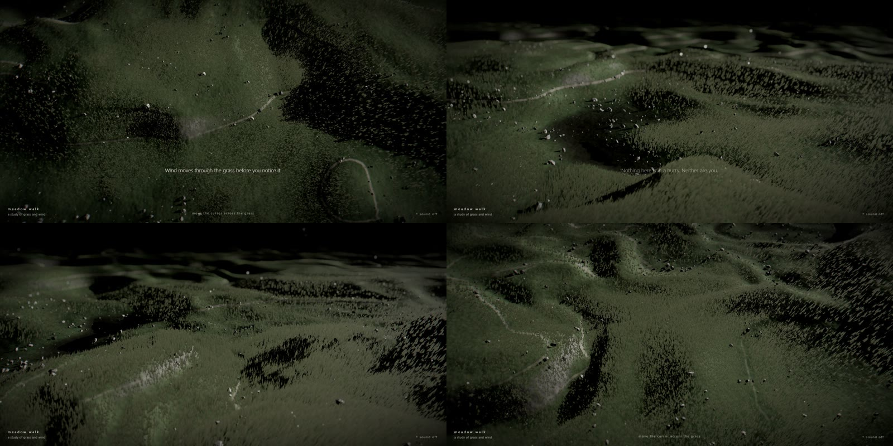

# Meadow Walk

An endless, unhurried flight over a dark windy meadow, rendered in the browser with React Three Fiber.
Move the cursor and soft waves roll through the grass, lifting pebbles and pollen before letting them settle.

**Live demo:** https://kloserock97-tech.github.io/meadow-walk/



## What's inside

- **One heightmap per frame.** Terrain height (warped fractal noise) is rendered once into a half-float texture around the camera; terrain, grass, pebbles and shadow passes only sample it.
- **~500k blades of GPU grass** in two layers (dense near the camera, sparse further out), placed, bent by wind and pushed by the cursor entirely in vertex shaders.
- **Cursor waves.** The cursor is ray-marched against a bit-exact JS copy of the terrain function; its trail spawns expanding rings that the grass, pebbles and dust all read from one shared shader field.
- **Adaptive quality.** Frame time is measured in 1.5 s windows; grass density eases up or down smoothly. Resolution is never changed at runtime (that causes a visible hitch).
- **Post-processing:** depth of field, bloom, chromatic aberration, ACES tone mapping, grading, a custom mid-tone film grain and vignette.
- **Procedural sound.** Wind synthesized with Web Audio (filtered noise with slow gusts), no audio files.

## Run

```bash
npm install
npm run dev
```

## URL parameters

| Parameter | Effect |
|---|---|
| `?t=40` | start the walk at second 40 |
| `?pause=1` | freeze time (cursor still works) |
| `?ui=0` | hide the interface |
| `?q=low` | lighter preset for weak GPUs |
| `?level=0..5`, `?adaptive=0` | fixed quality level / disable adaptive quality |
| `?fx=0`, `?off=dof,bloom,ca,grain` | diagnostics: disable post-processing or single effects |
| `?hide=grass,pebbles,dust,water`, `?shadows=0` | diagnostics: hide layers / shadows |

## Prior art

Instanced grass bent by wind in the vertex shader is a well-documented real-time technique, popularised
by the Ghost of Tsushima GDC talk. The dark palette, pebbles and contour-line paths began as a mood study
of immersive WebGL storytelling sites such as Chateau Oublié by Unseen Studio. The scene, camera, interface,
noise, shaders, sound and all of the code here are my own work, written from scratch; the only borrowed
piece is the public-domain lowbias32 integer hash by Chris Wellons. Built with [three.js](https://threejs.org),
[React Three Fiber](https://r3f.docs.pmnd.rs) and [postprocessing](https://github.com/pmndrs/postprocessing).

## Licence

MIT — see [LICENSE](LICENSE). Bundled open-source software is listed with its licences in
[THIRD_PARTY_NOTICES.md](THIRD_PARTY_NOTICES.md).
